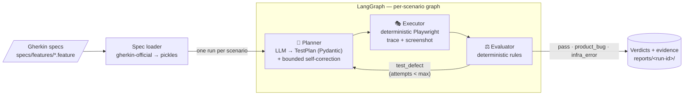

# ai-test-harness

[](https://github.com/tomduca/ai-test-harness/actions/workflows/checks.yml)

An AI-powered test harness built with **LangGraph** and **Playwright** (Python). LLM agents turn
Gherkin acceptance criteria into executable test plans, run them in a real browser, and classify
every failure as a **product bug**, a **test defect** or an **infrastructure error**, retrying
automatically when the test itself was wrong.

System under test: [www.lu2met.ar](https://www.lu2met.ar), the author's amateur radio website (LU2MET).

## How it works



| Stage | What it does | LLM? |
|---|---|---|
| **Spec loader** | Parses `.feature` files with the official Cucumber parser. Expands Scenario Outlines, prepends Backgrounds, assigns stable IDs (`feature::scenario[row]`). | No |
| **Planner** | Asks the LLM for a `TestPlan` in a **closed action vocabulary** (UI: `goto`, `click`, `fill`, `expect_items`…; API: `api_get`, `expect_status`, `expect_contract`, `expect_json`), validated by Pydantic. `@api` scenarios get the API contracts as context. A semantic layer checks the plan fits the scenario and asks the LLM to self-correct, up to a bound. Proven plans are reused from a cache. | Yes (cache misses only) |
| **Executor** | Dispatches each action to Playwright (browser or `APIRequestContext`). Failed interactions and unexpected HTTP statuses stop the run; other assertions are soft. Saves `plan.json`, `execution.json`, a Playwright trace and a screenshot per attempt. | No || **Evaluator** | Classifies the result from Playwright's error signatures. Only `test_defect` loops back to the planner, with the concrete failure as feedback. | No |

The LLM is fenced in by deterministic layers on both sides: schema and semantic validation before
execution, rule-based evaluation after it.

## A real run

```text
$ uv run ai-test-harness
pass         navigation::each-menu-item-takes-the-visitor-to-its-content[1]  (attempts: 1)
pass         navigation::each-menu-item-takes-the-visitor-to-its-content[2]  (attempts: 1)
pass         navigation::each-menu-item-takes-the-visitor-to-its-content[3]  (attempts: 1)
pass         navigation::each-menu-item-takes-the-visitor-to-its-content[4]  (attempts: 1)
pass         navigation::each-menu-item-takes-the-visitor-to-its-content[5]  (attempts: 1)
pass         navigation::the-home-page-loads-cleanly  (attempts: 1)
product_bug  navigation::the-main-menu-offers-exactly-the-expected-items  (attempts: 1)
             step 1 expect_items: the element exists but the assertion failed.
             Expected: ['Proyectos', 'En el aire', 'QSOs', 'Taller', 'Directorio']
             Actual:   ['Proyectos', 'En el aire', 'Mapa', 'QSOs', 'Taller', 'Directorio']
product_bug  navigation::switching-the-site-language-to-english  (attempts: 1)
             step 3 expect_items: ... Actual: ['Projects', 'On the air', 'Map', 'QSOs', ...]

8 scenarios: 6 pass, 2 product_bug, 0 test_defect, 0 infra_error
```

Both bugs are real: a redundant "Mapa"/"Map" menu item that points to a sub-heading of another
section. In an earlier run, the language scenario showed the retry loop at work: attempt 1 scoped
the "EN" link to the navigation landmark, where it does not live (`test_defect`); attempt 2 fixed
the locator and found the bug.

## API testing

The QSO lookup feature tests the site's public API and its UI from the same Gherkin file:

```gherkin
  @api
  Scenario Outline: Base and portable forms of a callsign find each other's QSOs
    When I look up the callsign "<callsign>" through the API
    Then the response says the station was found
    And the response contains a QSO logged as "<logged_as>"
```

- **Contracts as code and as context.** [`docs/contracts/`](docs/contracts/) is the human-readable
  contract; `contracts.py` is its strict, executable version (`extra="forbid"`, strict types).
  The same document is given to the planner for `@api` scenarios, so specs never mention
  endpoints or field names.
- **Shape vs content.** `expect_contract` validates the whole response; `expect_json` checks
  scenario-specific content with a closed set of operations (`equals`, `any_item_has`,
  `all_items_have`, `younger_than_hours`…).
- **No assertions on third-party data.** LoTW confirmation status is owned by LoTW: the contract
  checks its type, never its value.
- **Tested against a real local HTTP server**, including URL encoding of `/` and whitespace.

## Design decisions

Highlights (full log with rationale in [`docs/design-notes.md`](docs/design-notes.md)):

- **Closed action vocabulary, not generated code.** No `exec()` of LLM output; every action is
  validated, auditable and has exactly one deterministic handler (enforced by a test).
- **Guardrails in the schema.** Site-relative paths only; a small set of ARIA roles; accessible
  locators preferred over CSS; whole-text, case-insensitive name matching.
- **Provider-agnostic, observable LLM chain.** `LLM_MODELS` is an ordered list of `provider:model`
  entries (Groq, Gemini), each qualified against the plan schema. Each model fails fast; the chain
  reports every failure and records which model answered. Requests are paced client-side.
- **Four outcomes, not two.** `pass`, `product_bug`, `test_defect`, `infra_error`, so a provider
  outage or a bad locator never shows up as "the site is broken".
- **Everything bounded.** Timeouts per action and per LLM call, self-corrections and graph retries.
- **Evidence first.** Every attempt keeps its plan, its result and a Playwright trace; most
  harness bugs in this project were found by diffing that evidence.
- **Cascades are prevented, not interpreted.** An unexpected HTTP status skips the body checks
  that follow, so the evaluator sees the one real failure.
- **Quota-aware.** Provider failures are classified (daily quota, rate limit, unavailable);
  transient ones are retried once, exhausted daily quotas never.
- **Proven-plan cache.** Passing plans are reused while the scenario, prompt, vocabulary and
  contracts are unchanged: daily runs cost almost no tokens and are deterministic.

## Project structure

```text
src/ai_test_harness/
├── graph.py            # LangGraph wiring and retry routing
├── state.py            # per-scenario graph state (TypedDict)
├── llm.py              # provider-agnostic model chain with fallbacks
├── specs_loader.py     # Gherkin → validated, traceable scenarios
├── runner.py           # runs the graph over every scenario + CI job summary
├── nodes/              # planner, executor, evaluator
└── schemas/            # Pydantic contracts: scenario, plan, results
specs/features/         # acceptance criteria (input)
tests/                  # unit tests + contract tests against a fake site
docs/design-notes.md    # decisions, limitations, findings
.github/workflows/      # checks (every push) and e2e (scheduled)
```

## Getting started

Requirements: [uv](https://docs.astral.sh/uv/) and free API keys from
[Groq](https://console.groq.com/keys) and/or [Google AI Studio](https://aistudio.google.com).

```bash
git clone https://github.com/tomduca/ai-test-harness.git
cd ai-test-harness
uv sync
uv run playwright install chromium
uv run pre-commit install   # lint + format on every commit
cp .env.example .env        # then add your API keys
```

```bash
uv run ai-test-harness                  # run every scenario (exit code 1 if anything fails)
uv run ai-test-harness main-menu        # run scenarios whose id contains "main-menu"
uv run playwright show-trace reports/<run-id>/<scenario>/attempt-1/trace.zip
```

## Testing the harness itself

```bash
uv run pytest            # unit + contract tests: no network, no LLM (fake LLMs, in-memory fake site)
uv run pytest -m live    # contract tests against the real LLM (uses quota)
```

The executor and evaluator are tested against a fake website served through Playwright's
`context.route()`, including contract tests that pin the evaluator rules to **real** Playwright
error messages.

## Continuous integration

Two workflows with different meanings:

| Workflow | Runs on | What it checks | Red means |
|---|---|---|---|
| [`checks`](.github/workflows/checks.yml) | every push and PR | ruff (format + lint) and all harness tests, on Linux, no network, no LLM | the **harness code** is broken |
| [`e2e`](.github/workflows/e2e.yml) | daily schedule + manual | the full graph against the live site, with the LLM | the **site** has bugs (or a provider failed: `infra_error`) |

- **Evidence:** every e2e run uploads `reports/` (plan, execution result, Playwright trace and
  screenshot per attempt) as an artifact, even when it fails.
- **Job summary:** a verdict table with collapsible failure details on the run page.
- **Secrets** (`GROQ_API_KEY`, `GOOGLE_API_KEY`) live in GitHub; non-secret settings
  (`LLM_MODELS`, `LLM_REQUESTS_PER_MINUTE`) are repository variables.
- **Injection-safe inputs:** the manual `only` filter reaches the shell through an environment
  variable, never interpolated into the command.
- **Local gate:** pre-commit runs the project's own ruff (locked in `uv.lock`) on every commit.
  Dependabot keeps actions and dependencies updated; its PRs go through `checks`, and their
  release notes are reviewed before merging.

```bash
gh workflow run e2e.yml                    # all scenarios
gh workflow run e2e.yml -f only=main-menu  # a subset
gh run download <run-id> -D ci-reports     # evidence, then: uv run playwright show-trace <trace.zip>
```

## Known limitations

- A removed element and a wrong locator produce the same signal ("no elements") and are classified
  as `test_defect`. This is the motivating case for the LLM-as-judge stage.
- LLM plans are not deterministic; each attempt's `plan.json` is kept as evidence.
- Free-tier rate limits: under load a scenario may end as `infra_error` (reported, never as a bug).
- See [`docs/design-notes.md`](docs/design-notes.md) for the full list.

## Roadmap

- [x] MVP: planner → executor → deterministic evaluator, with retry loop and evidence
- [x] GitHub Actions CI: lint gate, harness tests, scheduled runs with reports as artifacts
- [x] API testing: QSO lookup endpoint with contract validation and JSON assertions
- [ ] Multi-target: core vs per-site target (specs, contracts as schemas, approved plans)
- [ ] Contract owned by the site repo; site deploys trigger the e2e run
- [ ] Agent-assisted onboarding of a new target (proposes specs; a human approves)
- [ ] LLM-as-judge for ambiguous failures and cascades (trace + page snapshot as evidence)
- [ ] Planner with ARIA snapshot, measured against the blind planner
- [ ] Executor via the Playwright MCP server
- [ ] Parallel scenarios with LangGraph `Send` and an HTML report