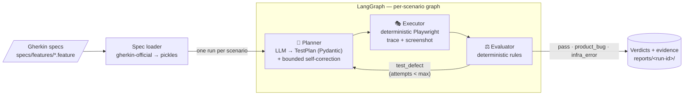

# ai-test-harness
[](https://github.com/tomduca/ai-test-harness/actions/workflows/checks.yml)

An AI-powered test harness built with **LangGraph** and **Playwright** (Python). LLM agents turn
Gherkin acceptance criteria into executable test plans, run them in a real browser, and classify
every failure as a **product bug**, a **test defect** or an **infrastructure error**, retrying
automatically when the test itself was wrong.

System under test: [www.lu2met.ar](https://www.lu2met.ar), the author's amateur radio website (LU2MET).

## How it works



| Stage | What it does | LLM? |
|---|---|---|
| **Spec loader** | Parses `.feature` files with the official Cucumber parser. Expands Scenario Outlines, prepends Backgrounds, assigns stable IDs (`feature::scenario[row]`). | No |
| **Planner** | Asks the LLM for a `TestPlan` in a **closed action vocabulary** (`goto`, `click`, `expect_items`, …), validated by Pydantic. A second, semantic layer checks the plan fits the scenario (every step covered, every `Then` asserted) and asks the LLM to self-correct, up to a bound. | Yes |
| **Executor** | Dispatches each action to Playwright. Failed interactions stop the run; failed assertions are soft. Saves `plan.json`, a Playwright trace and a screenshot per attempt. | No |
| **Evaluator** | Classifies the result from Playwright's error signatures. Only `test_defect` loops back to the planner, with the concrete failure as feedback. | No |

The LLM is fenced in by deterministic layers on both sides: schema and semantic validation before
execution, rule-based evaluation after it.

## A real run

```text
$ uv run ai-test-harness
pass         navigation::each-menu-item-takes-the-visitor-to-its-content[1]  (attempts: 1)
pass         navigation::each-menu-item-takes-the-visitor-to-its-content[2]  (attempts: 1)
pass         navigation::each-menu-item-takes-the-visitor-to-its-content[3]  (attempts: 1)
pass         navigation::each-menu-item-takes-the-visitor-to-its-content[4]  (attempts: 1)
pass         navigation::each-menu-item-takes-the-visitor-to-its-content[5]  (attempts: 1)
pass         navigation::the-home-page-loads-cleanly  (attempts: 1)
product_bug  navigation::the-main-menu-offers-exactly-the-expected-items  (attempts: 1)
             step 1 expect_items: the element exists but the assertion failed. Locator expected to have text '['Proyectos', 'En el aire', 'QSOs', 'Taller', 'Directorio']'
             Actual value: ['Proyectos', 'En el aire', 'Mapa', 'QSOs', 'Taller', 'Directorio'] 
             Call log:
               - Expect "to_have_text" get_by_role("navigation").get_by_role("link") with timeout 5000ms
               - waiting for get_by_
product_bug  navigation::switching-the-site-language-to-english  (attempts: 2)
             step 3 expect_items: the element exists but the assertion failed. Locator expected to have text '['Projects', 'On the air', 'QSOs', 'Workshop', 'Directory']'
             Actual value: ['Projects', 'On the air', 'Map', 'QSOs', 'Workshop', 'Directory'] 
             Call log:
               - Expect "to_have_text" get_by_role("navigation").get_by_role("link") with timeout 5000ms
               - waiting for get_by_r

8 scenarios: 6 pass, 2 product_bug, 0 test_defect, 0 infra_error

```

The language scenario shows the retry loop: attempt 1 scoped the "EN" link to the navigation
landmark, where it does not live (`test_defect`); attempt 2 fixed the locator and found the real bug.

## Design decisions

Highlights (full log with rationale in [`docs/design-notes.md`](docs/design-notes.md)):

- **Closed action vocabulary, not generated code.** No `exec()` of LLM output; every action is
  validated, auditable and has exactly one deterministic handler (enforced by a test).
- **Guardrails in the schema.** Site-relative paths only; a small set of ARIA roles; accessible
  locators preferred over CSS.
- **Provider-agnostic, observable LLM chain.** `LLM_MODELS` is an ordered list of `provider:model`
  entries (Groq, Gemini). Each model fails fast; the chain reports every failure and records which
  model answered.
- **Four outcomes, not two.** `pass`, `product_bug`, `test_defect`, `infra_error`, so a provider
  outage or a bad locator never shows up as "the site is broken".
- **Everything bounded.** Timeouts per action and per LLM call, self-corrections and graph retries.

## Project structure

```text
src/ai_test_harness/
├── graph.py            # LangGraph wiring and retry routing
├── state.py            # per-scenario graph state (TypedDict)
├── llm.py              # provider-agnostic model chain with fallbacks
├── specs_loader.py     # Gherkin → validated, traceable scenarios
├── runner.py           # runs the graph over every scenario
├── nodes/              # planner, executor, evaluator
└── schemas/            # Pydantic contracts: scenario, plan, results
specs/features/         # acceptance criteria (input)
tests/                  # unit tests + contract tests against a fake site
docs/design-notes.md    # decisions, limitations, findings
```

## Getting started

Requirements: [uv](https://docs.astral.sh/uv/) and free API keys from
[Groq](https://console.groq.com/keys) and/or [Google AI Studio](https://aistudio.google.com).

```bash
git clone https://github.com/tomduca/ai-test-harness.git
cd ai-test-harness
uv sync
uv run playwright install chromium
cp .env.example .env        # then add your API keys
```

```bash
uv run ai-test-harness                  # run every scenario (exit code 1 if anything fails)
uv run ai-test-harness main-menu        # run scenarios whose id contains "main-menu"
uv run playwright show-trace reports/<run-id>/<scenario>/attempt-1/trace.zip
```

## Testing the harness itself

```bash
uv run pytest            # 59 tests, no network and no LLM: fake LLMs and an in-memory fake site
uv run pytest -m live    # contract tests against the real LLM (uses quota)
```

The executor and evaluator are tested against a fake website served through Playwright's
`context.route()`, including contract tests that pin the evaluator rules to **real** Playwright
error messages.

## Known limitations

- A removed element and a wrong locator produce the same signal ("no elements") and are classified
  as `test_defect`. This is the motivating case for the LLM-as-judge stage.
- LLM plans are not deterministic; each attempt's `plan.json` is kept as evidence.
- See [`docs/design-notes.md`](docs/design-notes.md) for the full list.

## Roadmap

- [x] MVP: planner → executor → deterministic evaluator, with retry loop and evidence
- [ ] GitHub Actions CI: lint gate, harness tests, scheduled runs with reports as artifacts
- [ ] API testing: QSO lookup endpoint (`/api/qso`) with new `api_*` actions
- [ ] LLM-as-judge for ambiguous failures (trace + page snapshot as evidence)
- [ ] Planner with ARIA snapshot, measured against the blind planner
- [ ] Executor via the Playwright MCP server
- [ ] Parallel scenarios with LangGraph `Send` and an HTML report